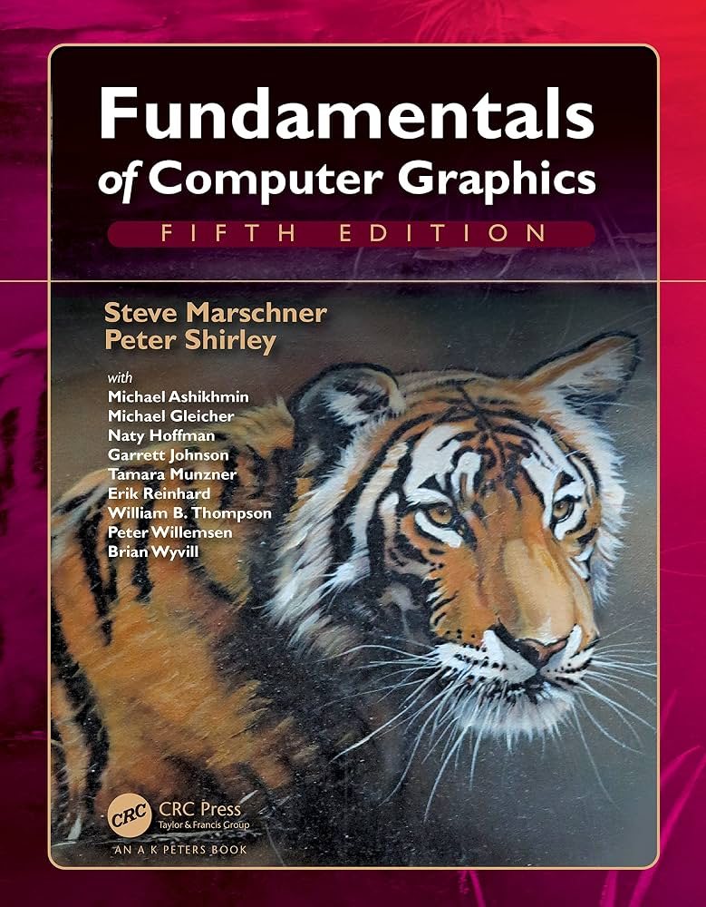
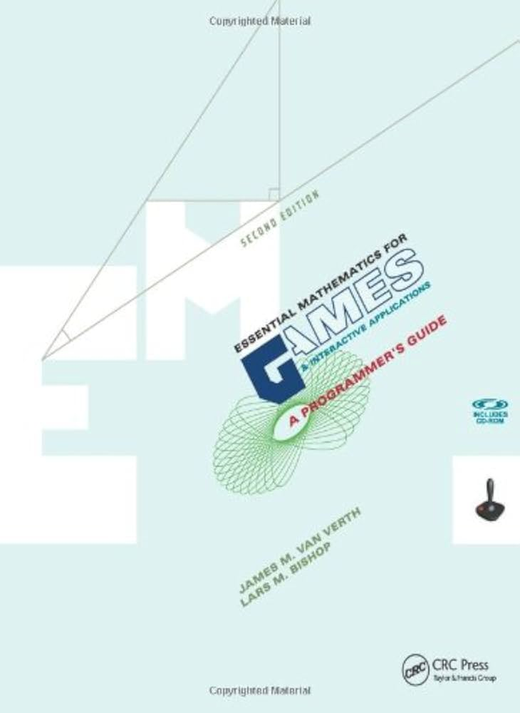

# MonoCUDA-PT
MonoCUDA is an original CUDA path tracer whose renderer is a single source file; three small third-party libraries (a pbrt-v3 parser and two image decoders) are fetched at configure time and compiled next to it. It was started after completing Peter Shirley's Ray Tracing in One Weekend series in C++, with the goal of understanding how physically based rendering, specifically Monte Carlo path integration, maps onto GPU hardware rather than a single CPU thread. It is not based on or derived from NVIDIA's official CUDA port of the same book.

The renderer is deliberately kept in one file. The intent is for the source to read as a continuous explanation of a GPU path tracer's design, from ray generation through BVH traversal, material evaluation, and light transport, rather than as a general-purpose rendering engine split across many files. Kernels are written iteratively rather than recursively, since recursion on GPU forces register spilling and reduces occupancy.

The project follows a standard Monte Carlo path tracing formulation: primary rays are generated per pixel, intersected against scene geometry accelerated by a bounding volume hierarchy, and shaded using physically based materials (diffuse, dielectric, conductor, and emissive) and a homogeneous isotropic participating medium (smoke). Direct lighting uses next event estimation (NEE) with shadow rays against area lights, combined with BSDF sampling through multiple importance sampling (power heuristic). The renderer supports motion blur through time-sampled rays and moving spheres, and textured surfaces: solid colors, a procedural checker and image textures, with UV mapping on spheres and triangles and hardware-filtered image sampling through `cudaTextureObject_t`. Triangle meshes can be loaded from Wavefront OBJ files (`v`, `vt`, `vn` and `f`; smooth shaded when the file carries vertex normals, flat otherwise) together with their MTL materials (`Kd`, `map_Kd` and `Ke`, so a model can bring its own area lights), and the renderer ships with eleven selectable scenes: a Cornell box, the Sponza atrium, the Stanford bunny and dragon, a living room, the Sibenik cathedral, a textured UV sphere, and four pbrt-v3 scenes (Barcelona pavilion, a contemporary bathroom, the pbrt book cover and the San Miguel courtyard). Any scene can additionally be lit by an equirectangular HDR environment map, which is importance sampled from its luminance and combined with BSDF sampling and the area lights through MIS. Correctness checks against a CPU reference implementation are planned (see below checklist). Measured single-kernel versus wavefront timings are listed in the Benchmarks section.

Two execution models are implemented side by side and produce the same image: a single-kernel path tracer (the default), where one thread follows a whole path, and a wavefront path tracer (`--wavefront`), which splits every bounce into separate extend, shade and shadow-ray kernels connected by compacted path queues and a structure-of-arrays path state. The wavefront version raises the average number of active threads per warp from about 7 to about 27 on the first bounce, at the cost of extra memory traffic. With `--persistent` the wavefront extend kernel additionally keeps each ray's traversal state in its lane and hands a finished lane a new ray from a global work counter, so warps stay busy on the incoherent later bounces; the image stays bit-identical. The extend kernel also stores only a packed 16-byte hit record and the shade kernel rebuilds the surface data from it (deferred hit shading).

Building requires the CUDA Toolkit (12.x or later), CMake 3.24 or later, and a CUDA-capable NVIDIA GPU. From the repository root:

```
cmake --preset release
cmake --build --preset release
./build/release/monocuda                                  # single-kernel path tracer, Cornell box
./build/release/monocuda --wavefront                     # wavefront path tracer
./build/release/monocuda --wavefront --persistent        # wavefront with persistent threads in the extend kernel
./build/release/monocuda --scene sponza --spp 1000       # choose the scene and the sample count
./build/release/monocuda --wavefront --tonemap aces --exposure 0.6   # tone mapping and exposure
./build/release/monocuda --scene bunny --env sky.hdr --env-intensity 1 --env-rotation 90   # HDR environment map (.hdr, .exr or .pfm)
./build/release/monocuda --pbrt models/coffee/scene.pbrt --tonemap aces   # a pbrt-v3 scene: camera, lights and materials from the file
./build/release/monocuda                                  # no arguments in a terminal: interactive menu
```

The render is written to `render_megakernel.png` or `render_wavefront.png` in the current directory, depending on the execution model (8 bit RGB through `stb_image_write`). The Cornell box scene loads an `earth.ppm` image texture (binary PPM, P6) from the current directory. `--scene` selects `cornell` (default), `sponza`, `bunny`, `dragon`, `living_room`, `sibenik`, `sphere`, `barcelona`, `bathroom`, `book` or `sanmiguel`, and `--spp N` overrides the number of samples per pixel, and `--persistent` (only together with `--wavefront`) selects the persistent-threads extend kernel. `--tonemap none|reinhard|aces` selects the tone mapping operator (default `none`) and `--exposure X` multiplies the averaged radiance before tone mapping (default 1.0; ACES is brighter than `none`, so around 0.6 looks closer). Started without any arguments in a terminal, the program shows a small interactive menu for the execution model, the scene, the sample count, the tone mapping and the exposure; runs with arguments and pipes skip it. The models are not part of the repository. Download the OBJ versions from the McGuire Computer Graphics Archive (https://casual-effects.com/data/), respect the `copyright.txt` files that come with them, and extract them so that `models/sponza/sponza.obj`, `models/bunny/bunny.obj`, `models/dragon/dragon.obj`, `models/living_room/living_room.obj`, `models/sibenik/sibenik.obj` and `models/sphere/sphere-cylcoords-16k.obj` exist. The loader reads the `.mtl` next to each model (`newmtl`, `Kd`, `map_Kd`, `Ke`; other keywords are ignored); a material with a non-zero `Ke` becomes an area light, which is how the living room is lit through its window panels. A `usemtl` name that the `.mtl` does not define falls back to the only material in the file when there is just one, otherwise to the scene's fallback material, and the console says so either way. The bunny, dragon and sphere are placed inside the Cornell box, Sponza gets a sun and a blue sky quad above its atrium when no environment map is given, and Sibenik is lit through its window glass (set `Ke` on the `staklo` materials of its `.mtl`, the archive version ships them black). Image textures are decoded with `stb_image` (PNG, JPG, BMP, TGA, PPM); a `.ppm` next to the original with the same name is still picked up first, so previously converted textures keep working.


The console reports `N materials, M textures loaded, K materials with a missing texture` when the model is loaded. A material whose texture is missing falls back to its `Kd` color. `--env file` lights the scene with an equirectangular environment map, read as Radiance `.hdr` (`stb_image`), OpenEXR `.exr` (`tinyexr`) or binary little-endian `.pfm`; `--env-intensity X` scales it and `--env-rotation D` turns it around the vertical axis in degrees. (`scripts/hdr2pfm.py` still converts `.hdr` to `.pfm` with numpy if a PFM is wanted; ImageMagick builds without HDRI support clamp everything above 1.0, so do not convert with those.) With an environment map the Sponza scene drops its own sky and sun quads; scenes whose lights come from their `.mtl` keep them. The four pbrt scenes are the same loader behind a name; they expect `models/pbrt-v3-scenes/<scene>/` from the pbrt-v3 scene bundle (https://pbrt.org/scenes-v3, one 4 GB archive). `--pbrt file.pbrt` loads any other pbrt-v3 scene through minipbrt (https://github.com/vilya/minipbrt): triangle and PLY meshes, spheres and the other quadrics (triangulated), object instances, the camera with its film resolution and field of view, `diffuse` area lights, `infinite` lights (the map becomes the environment map, a constant one the background color), and homogeneous media on `interface` shapes. Materials are reduced to what the renderer has: `matte`, `plastic`, `substrate`, `uber`, `disney`, `mix` and the rest render as lambertian with their diffuse color or texture, `glass` as a dielectric, `mirror` and `metal` as conductors (the metal's reflectance from its `eta`/`k` at normal incidence, roughness as fuzz). `distant` lights become a small bright quad far away in their direction, `point` and `spot` lights a tiny emissive cube, so they can be sampled by NEE; the console lists every approximation. Instances are flattened into real triangles, so a scene that pbrt renders from a few instanced meshes can expand far beyond what fits in memory; the triangle count is checked against the free device memory before anything is built and the load stops with a message instead of exhausting the machine. `--max-triangles N` raises the limit. The Barcelona pavilion's instanced vegetation (`../landscape`) is 97M triangles for that reason and is left out, the architecture itself is 130k. pbrt-v4 files are not supported, the two libraries that parse pbrt only read v3; Benedikt Bitterli's scenes (https://benedikt-bitterli.me/resources/) and `pbrt-v3-scenes` are the ones to use. Alpha-masked parts of Sponza (leaves, chains, plants) are not supported yet and render as solid quads. The accumulation buffer stays in linear radiance; the resolve kernel applies exposure, the selected tone mapping operator and the sRGB transfer function once per pixel. The colors of the built-in scenes are picked by eye, so they are treated as sRGB values and converted to linear when the textures are built (emissive colors are not converted).

The project's implementation status is tracked in CHECKLIST.md. It is licensed under the MIT License.

# Benchmarks

Single-kernel versus wavefront path tracing, measured with the release build on an RTX 5070 Laptop GPU (36 SMs). Settings: 600x600 pixels, 1000 samples per pixel, maximum path depth 20. Times are the render loop only (BVH construction excluded), one run each.

| Scene | Primitives | Single-kernel | Wavefront | Speedup |
|---|---|---|---|---|
| Cornell box | 24 triangles + spheres | 13.99 s | 13.81 s | 1.01x |
| Sponza atrium | 262,268 triangles | 191.44 s | 105.36 s | 1.82x |

On the small Cornell scene both execution models take about the same time. A plausible reason, not yet verified with a profiler, is that the extra memory traffic of the wavefront path state cancels what it gains on such a small scene. On Sponza the wavefront version is clearly faster, most likely because rays traverse a large hierarchy incoherently, threads of a warp diverge more inside the single kernel, and compacting the active paths between bounces reduces that. These are single measurements and the Sponza scene used one placeholder material at that time, so treat the numbers as a first data point rather than a full benchmark.

## Effect of a 16-byte aligned AABB

Profiling the wavefront `extendKernel` on Sponza with Nsight Compute showed that about 76% of its global load requests came from reading the child bounding boxes during traversal. `AABB` was 36 bytes and unaligned (it carried an unused `centroid`), so the compiler emitted 12 separate 4-byte loads per box. Removing the unused field and padding the box to 32 bytes with 16-byte alignment (`alignas(16)`) lets it be read with vector loads (4 load instructions per box instead of 12 in the source view); `BVH_Node` grows to exactly 64 bytes as a side effect.

| Sponza, wavefront, 1000 spp | Time | Mpaths/s | Speedup |
|---|---|---|---|
| Before (36-byte `AABB`, placeholder material) | 105.36 s | 3.42 | 1.00x |
| After (32-byte aligned `AABB`, MTL textures loaded) | 88.01 s | 4.09 | 1.20x |

Nsight Compute's estimated remaining speedup for `extendKernel` dropped from about 63% to 46.6%, and the kernel is now limited more by computation (57% of peak) than by memory throughput (30% of peak). The two runs differ in more than the `AABB` layout: the second one renders the textured Sponza, which adds shading work, so the gain from the layout change alone is probably slightly larger than 1.20x. The single-kernel path tracer has not been re-measured since this change.

## Effect of persistent threads in the extend kernel

With `--wavefront --persistent` the extend kernel launches a fixed grid that exactly fills the GPU (SM count times the resident blocks per SM). A lane that finishes its ray asks for a new one while the other lanes of its warp keep traversing: when at least 8 lanes of a warp are idle, one lane performs a single `atomicAdd` on a global work counter for the whole warp and the new queue slots are distributed to the idle lanes with a prefix popcount. The traversal loop of `traverseRay` was split into `beginTraversal` and `stepTraversal` so that a lane can carry its ray state across iterations. Every ray still performs exactly the same operations in the same order, and the rendered image is byte-identical to the normal wavefront renderer (checked with `cmp`).

| Sponza, wavefront, 1000 spp | Time | Mpaths/s | Speedup |
|---|---|---|---|
| Normal extend kernel | 88.11 s | 4.09 | 1.00x |
| Persistent threads (`--persistent`) | 78.23 s | 4.60 | 1.13x |

Both rows were measured back to back in the same session. Nsight Compute on the extend kernel at bounce depth 3 showed the average number of active threads per warp rising from 6.35 to 15.33, the kernel time dropping from 18.2 ms to 10.2 ms, and registers per thread dropping from 71 to 56. The gain on the whole frame is smaller because the extend kernel is only part of it: an `nsys` run showed the persistent extend kernel at 66% of the GPU time, the shadow-ray kernel at 28% and the shade kernel at 3%. The shadow-ray kernel still uses one thread per ray. The extend kernel is now limited by memory (about 80% of peak memory throughput), mostly local memory traffic from the traversal stack and scattered stores of the hit results.

## Effect of deferred hit shading

In the wavefront renderer the extend kernel used to carry a full `hitRecord` (hit point, normal, front-face flag, UV and a copy of the `Material`) through the traversal and wrote it out as twelve separate arrays. Nsight Compute showed this as local-memory traffic inside the persistent traversal state and as scattered 4-byte stores that saturate L2. Now `extendKernel` only tracks the closest candidate (`distance`, `primitiveType`, `primitiveIndex`) and writes a single 16-byte `PackedHit`. `shadeKernel` reads it back and recomputes the hit point, normal, front-face flag and UV with the same formulas the traversal used to run, so the extra arithmetic is paid once per hit instead of once per candidate triangle.

| Sponza, wavefront + persistent, 50 spp | Time | Mpaths/s | Speedup |
|---|---|---|---|
| Before (hit record built during traversal) | 3.975 s | 4.53 | 1.00x |
| After (`PackedHit`, shading data rebuilt in `shadeKernel`) | 3.540 s | 5.08 | 1.12x |

Both rows are the mean of three runs measured back to back in the same session (the laptop GPU throttles, so numbers from different sessions are not comparable). The rendered image is byte-identical to the one from before the change (checked with `cmp`). `cuobjdump -sass` shows the number of local-memory instructions (`LDL`/`STL`) in `extendKernelPersistent` dropping from 139 to 33; most of the remaining ones belong to the traversal stack.

## Experiments that did not help

- **`__ldg` / read-only data path on the BVH loads:** no measurable change in time, so it was not kept.
- **Persistent threads in the shadow-ray kernel:** the average number of active threads per warp rose from 12.66 to 18.09 (Nsight Compute), but the kernel got slower (4.10 ms to 4.31 ms, about 5% on the whole frame). The extra bookkeeping per traversal step (refill vote, state save/restore) costs more than the divergence it removes, because shadow rays are any-hit and terminate early. The change was reverted.

A higher active-thread ratio therefore does not guarantee a faster kernel; the loop adds its own instructions.

# Implementation Checklist

## 1. Core Rendering Pipeline
- [x] Device query + context setup (print GPU name, compute capability, SM count)
- [x] `vec3`/`float3` math library (add/sub/scale/dot/cross/normalize/reflect/refract)
- [x] `ray` type + camera-to-ray generation
- [x] Pinhole camera (position, look-at, FOV, aspect ratio)
- [x] Thin-lens camera model — aperture + focus distance (depth of field)
- [x] HDR framebuffer (float3/float4 per pixel), accumulated across samples
- [x] Progressive rendering loop (N samples/pixel, accumulate + save incrementally)

## 2. Scene Representation & Acceleration Structures
- [x] Primitive types: sphere, and at least one more (triangle)
- [ ] Structure-of-arrays scene layout (not array-of-structs) for coalesced access *(path state and hit results are already SoA in the wavefront renderer; scene geometry is still array-of-structs. For BVH nodes a compact, aligned array-of-structs is the better layout, since a traversal step reads whole nodes; the open item is a hot/cold split of the triangle data)*
- [x] BVH construction (LBVH build via Morton codes + Karras parallel radix-tree algorithm; Morton codes and sort on the CPU, tree construction and bounds refit on the GPU; primitives with identical Morton codes are separated by their index, and `findSplit` uses the same `delta` function as `determineRange` so that such runs build a consistent tree)
- [x] BVH traversal (device-side, iterative, stack-based — no recursion)
- [x] Bounding-box (AABB) intersection + slab test
- [ ] **(stretch)** SAH (surface area heuristic) BVH build for better traversal quality
- [x] **(stretch)** Basic OBJ mesh loading so you can render more than primitives *(dependency-free parser for `v`, `vt` and `f` with negative indices and polygon fan triangulation; the model is centered, scaled, rotated around Y and translated into the scene; flat shading only)*
- [x] **(stretch)** MTL parsing so loaded models keep their original per-material colors and textures (`Kd`, `map_Kd`) *(`newmtl`, `Kd`, `map_Kd` and `Ke`; textures decoded with `stb_image`, cached by path; alpha masks, `Ks`, bump maps and texture options are ignored)*
- [x] **(stretch)** PLY mesh loading *(minipbrt's reader is used directly by `loadPlyObject`, which places a mesh the same way the OBJ loader does; the Cornell dragon comes from the pbrt `dragon_remeshed.ply`)*
- [x] **(stretch)** pbrt-v3 scene loading *(minipbrt does the parsing and the PLY reading; the scene graph is flattened into the renderer's triangle list with instances expanded, materials mapped onto the four built-in ones, delta lights emulated with small emitters; see the usage notes above)*
- [x] **(stretch)** Smooth shading from OBJ vertex normals (`vn`) or averaged vertex normals *(the loader keeps the `vn` of each corner, rotated with the model; the hit normal is the barycentric interpolation of the three, flipped into the hemisphere of the geometric normal, and the geometric normal still decides front/back faces so dielectrics and media are unaffected; files without `vn` stay flat shaded)*

## 3. Materials / BSDFs
- [x] Lambertian (diffuse) BSDF — cosine-weighted hemisphere sampling
- [x] Specular/mirror reflection
- [x] Dielectric (glass) BSDF — Fresnel + refraction (Schlick approximation)
- [x] Rough conductor (metal) BSDF — at least a fuzz/roughness parameter
- [x] Emissive materials (area light sources built from geometry)
- [ ] **(stretch)** Real microfacet BSDF (GGX distribution) instead of ad-hoc fuzz
- [ ] **(stretch)** Energy-conserving material blending (e.g. dielectric-coated diffuse)

## 4. Textures & Surface Detail
- [x] UV coordinates on primitives (spherical mapping for sphere, barycentric for triangle)
- [x] Procedural checker texture and a `Texture` struct (solid / checker / image) wired into the materials' albedo
- [x] Image loading — binary PPM (P6) reader of its own plus `stb_image` for PNG/JPG/HDR and `tinyexr` for EXR, both compiled in a separate host translation unit so the renderer itself stays one `.cu` file
- [x] Image output — PNG through `stb_image_write` (the renders used to be plain-text P3 PPM, about ten times the size)
- [x] Hardware-accelerated sampling via `cudaTextureObject_t` (bilinear filtering on the GPU, wrap addressing) *(textures are created with the sRGB flag, so the hardware converts them to linear on fetch and the gamma-corrected output shows them unchanged)*
- [ ] **(stretch)** Normal mapping (tangent-space perturbation of the shading normal)
- [ ] **(stretch)** Roughness/metallic texture maps for the conductor BSDF

## 5. Light Transport & Sampling
- [x] Monte Carlo path integration — iterative bounce loop, not recursive
- [x] Russian roulette path termination (unbiased early exit)
- [x] Light list construction — collect emissive primitives from the scene into a separate array
- [x] Light sampling — pick a point on a triangle light (uniform area sampling) and compute its PDF, converted to solid angle
- [ ] Light sampling for sphere lights (solid-angle / cone sampling)
- [x] Light selection strategy for multiple lights (uniform; power-weighted is a possible upgrade)
- [x] Next event estimation (NEE) — explicitly sample lights each bounce instead of relying on BSDF sampling alone to find them
- [x] Multiple importance sampling (MIS) between light sampling and BSDF sampling — power heuristic, implemented in both the single-kernel and the wavefront path tracer *(on the current mostly diffuse scene with one small area light it does not reduce noise measurably, since NEE alone is already near-optimal there; its benefit shows up with large lights and glossy surfaces)*
- [x] Cosine-weighted / importance-sampled BSDF sampling (not uniform hemisphere)
- [x] **(stretch)** Environment map (HDRI) lighting with importance sampling *(equirectangular PFM in a float4 texture; a row CDF and per-row column CDFs over luminance times sin(theta) are built once on the host, NEE picks the environment with probability 0.5 next to the area lights (1.0 when the scene has none), samples a texel, jitters inside it and sends an unbounded shadow ray; the pdf is converted to solid angle and both the environment and the area lights get the matching selection probability in the power heuristic, so a path that reaches the sky by BSDF sampling is weighted against the same pdf)*
- [ ] **(stretch)** Stratified or low-discrepancy sampling (e.g. Sobol/blue-noise) instead of pure `curand` uniform — measurably reduces noise at equal sample count

## 6. Volumetric Rendering
- [x] Homogeneous participating media (constant-density fog/smoke) *(sphere-bounded `Isotropic` material with a density and an albedo; NEE from the scattering point and transmittance on shadow rays, in both the single-kernel and the wavefront renderer)*
- [x] Ray marching through volume bounds — absorption + scattering along the path *(done with analytic free-flight distance sampling instead of ray marching, since the medium is homogeneous; absorption comes from an albedo below 1)*
- [ ] Henyey-Greenstein phase function for scattering direction *(only the isotropic phase function $1/(4\pi)$ exists so far)*
- [ ] **(stretch)** Heterogeneous volumes (3D voxel grid for density — real smoke/cloud data)

## 7. Motion Blur
- [x] Per-sample time value on each ray (random within the shutter interval)
- [x] Time-interpolated primitive transforms (e.g. `center0`/`center1` lerp'ed by `time` for a moving sphere)
- [x] BVH handling for moving primitives — expanded bounding box covering the full motion range
- [ ] **(stretch)** Proper motion-aware BVH instead of a single expanded box per moving primitive

## 8. GPU Architecture-Specific Design
- [x] Iterative (not recursive) kernels throughout — verified with the register/stack usage report (`cuobjdump --dump-resource-usage`, equivalent to `nvcc --ptxas-options=-v`)
- [x] Persistent per-pixel RNG state, not reinitialized per sample
- [ ] Memory access audit: confirm scene/material reads go through `__ldg`/`const __restrict__` *(profiling showed plain `LDG.E` loads in `extendKernel`; the 16-byte aligned `AABB` is done, `__ldg` on the BVH loads gave no measurable gain, and `const __restrict__` kernel parameters and the child bounds stored inside the parent node are still open)*
- [x] Occupancy measurement (Nsight Compute or `nvidia-smi`) at a baseline milestone
- [x] **(stretch)** Wavefront path tracing — split trace/shade into separate kernels with stream compaction between bounces (this is how real production renderers like PBRT-on-GPU or Blender Cycles handle divergence; a genuine architectural upgrade over "one big kernel does everything") *(implemented with atomic-counter path queues, a separate shadow-ray queue for NEE, and SoA path state; selectable with `--wavefront`)*
- [ ] **(stretch)** Material-sorted shading — sort active paths by material ID before shading to reduce warp divergence
- [x] **(stretch)** Any-hit traversal for shadow rays (early exit on the first occluder, no hit record) *(used by the wavefront shadow kernel unless the scene contains a participating medium; the single-kernel path tracer still uses closest-hit traversal with a max distance)*
- [x] **(stretch)** Persistent threads / dynamic work fetching in BVH traversal to reduce divergence on incoherent bounces *(wavefront extend kernel only, `--wavefront --persistent`: fixed grid, one warp-aggregated `atomicAdd` on a global work counter, refill when at least 8 lanes of a warp are idle; 1.13x on Sponza at 1000 spp, bit-identical image; a persistent shadow-ray kernel was tried and was about 5% slower, so it is not used)*

## 9. Image Output & Post-Processing
- [x] Tonemapping operator (start with Reinhard or ACES-approx, not just clamp) *(selectable with `--tonemap none|reinhard|aces`, default `none`; applied in the resolve kernel to the averaged linear radiance, before the gamma step; Reinhard is `c / (1 + c)` per channel and ACES is the Narkowicz approximation; exposure is a separate multiplier set with `--exposure`, applied before the operator)*
- [x] Gamma correction (linear → sRGB) *(applied once in the resolve kernel with the exact sRGB transfer function; the accumulation buffer stays in linear radiance; hand-picked scene colors are linearized with `srgbToLinear` in `make_solid_texture` and `make_checker_texture`, so the scenes keep the look they were authored with)*
- [ ] PNG output (not just PPM) so renders are shareable without conversion
- [ ] **(stretch)** Simple denoiser pass (even a basic bilateral/edge-aware filter counts) to demonstrate you understand the variance-reduction vs. denoising trade-off

## 10. Tooling & Validation
- [ ] Benchmark harness reporting rays/sec and ms/frame at fixed sample counts
- [x] Numbers for at least one "before vs. after" optimization (e.g. BVH vs. brute force, or single-kernel vs. wavefront) recorded in the repo *(single-kernel versus wavefront on Cornell and Sponza, see Benchmarks)*
- [x] Command-line scene selection (a couple of hardcoded test scenes, switchable via flag) *(`--scene cornell|sponza`, plus `--spp N` for the sample count, `--tonemap none|reinhard|aces` for the tone mapping operator and `--exposure X` for the exposure)*
- [x] Interactive terminal menu (execution model, scene, samples per pixel, tone mapping, exposure) *(opens only when the program is started without arguments and both stdin and stdout are terminals, so scripted runs are unaffected; all choices are collected in a `RenderOptions` struct that the command line parser fills as well)*
- [x] Cornell box test scene (quads and a box built from triangles, emissive ceiling light, mirror sphere, many small spheres on the floor, a checker floor, a textured Earth sphere and a smoke sphere)
- [x] Sponza atrium test scene (262k triangles loaded from the McGuire OBJ with its MTL materials and 24 textures, a skylight quad above the open roof as the only light)

## References

- Peter Shirley, Trevor David Black, Steve Hollasch — *Ray Tracing in One Weekend* / *Ray Tracing: The Next Week* / *Ray Tracing: The Rest of Your Life* (https://raytracing.github.io/)
- NVIDIA Developer Blog — "Accelerated Ray Tracing in One Weekend in CUDA" (https://developer.nvidia.com/blog/accelerated-ray-tracing-cuda/)
- Tero Karras, NVIDIA Developer Blog — "Thinking Parallel, Part II: Tree Traversal on the GPU" (https://developer.nvidia.com/blog/thinking-parallel-part-ii-tree-traversal-gpu/)
- Tero Karras, NVIDIA Developer Blog — "Thinking Parallel, Part III: Tree Construction on the GPU" (https://developer.nvidia.com/blog/thinking-parallel-part-iii-tree-construction-gpu/)
- ToruNiina/lbvh (https://github.com/ToruNiina/lbvh) — used as a reference while designing and debugging MonoCUDA-PT's own LBVH construction and traversal; not used as source code

## Blog

I write about the process of building this project (BVH construction, profiling with Nsight Compute, and more) on my portfolio website: [borayalcinn.github.io](https://borayalcinn.github.io/)

## Reference Books

<p>
  
  &nbsp;&nbsp;
  
</p>

- Steve Marschner, Peter Shirley — *Fundamentals of Computer Graphics*, Fifth Edition, CRC Press / A K Peters
- James M. Van Verth, Lars M. Bishop — *Essential Mathematics for Games and Interactive Applications: A Programmer's Guide*, Second Edition, CRC Press
