# MonoCUDA-PT

MonoCUDA is an original CUDA path tracer whose renderer lives in a single source file (`src/path_tracer.cu`). It was started after completing Peter Shirley's *Ray Tracing in One Weekend* series in C++, with the goal of understanding how physically based rendering, specifically Monte Carlo path integration, maps onto GPU hardware rather than a single CPU thread. It is not based on or derived from NVIDIA's official CUDA port of the same book.

The renderer is deliberately kept in one file so that the source reads as a continuous explanation of a GPU path tracer, from ray generation through BVH traversal, material evaluation and light transport. Kernels are iterative rather than recursive, since recursion on a GPU forces register spilling and reduces occupancy. Four small third-party libraries (a pbrt-v3 parser, two image decoders and a PNG writer) are fetched at configure time and compiled in a separate host translation unit; see [Third-party code](#third-party-code).

## Features

- **Light transport:** Monte Carlo path integration with Russian roulette, next event estimation (NEE) against triangle area lights, and BSDF sampling combined through multiple importance sampling (power heuristic).
- **Materials:** diffuse, dielectric, conductor (with fuzz), emissive, and a homogeneous isotropic participating medium (smoke).
- **Camera:** pinhole and thin-lens (depth of field), motion blur through time-sampled rays and moving spheres.
- **Textures:** solid, procedural checker and image textures with hardware-filtered sampling through `cudaTextureObject_t`.
- **Geometry:** spheres and triangles in an LBVH (Morton codes plus the Karras parallel radix-tree build), traversed iteratively on the device.
- **Scenes:** twelve selectable scenes, Wavefront OBJ/MTL loading (smooth shaded when the file carries vertex normals) and pbrt-v3 scene import.
- **Environment lighting:** any scene can be lit by an equirectangular HDR map, importance sampled from its luminance and combined with BSDF sampling and the area lights through MIS.
- **Output:** linear accumulation buffer, exposure (manual or automatic), Reinhard/ACES tone mapping, sRGB transfer, PNG.
- **Two execution models** that produce the same image, described next.

### Execution models

The default is a single-kernel path tracer, where one thread follows a whole path. `--wavefront` selects a wavefront path tracer that splits every bounce into extend, shade and shadow-ray kernels connected by compacted path queues and a structure-of-arrays path state. It raises the average number of active threads per warp from about 7 to about 27 on the first bounce, at the cost of extra memory traffic.

With `--persistent`, the wavefront extend kernel additionally keeps each ray's traversal state in its lane and hands a finished lane a new ray from a global work counter, so warps stay busy on the incoherent later bounces; the image stays bit-identical. The extend kernel stores only a packed 16-byte hit record and the shade kernel rebuilds the surface data from it (deferred hit shading). Triangle data is split into a hot half (the three vertices, 36 bytes, all a BVH leaf test needs) and a cold half (UVs, vertex normals, material and bounding box) that is read only once a hit is known.

Measured numbers for each of these steps are in [Benchmarks](#benchmarks).

## Build and run

Requirements: CUDA Toolkit 12.x or later, CMake 3.24 or later, an NVIDIA GPU and a network connection for the first configure (the third-party libraries are fetched with CMake `FetchContent`).

```
cmake --preset release
cmake --build --preset release
./build/release/monocuda                                  # single-kernel path tracer, Cornell box
./build/release/monocuda --wavefront                      # wavefront path tracer
./build/release/monocuda --wavefront --persistent         # wavefront with persistent threads in the extend kernel
./build/release/monocuda --scene sponza --spp 1000        # choose the scene and the sample count
./build/release/monocuda --wavefront --tonemap aces --exposure auto
./build/release/monocuda --scene bunny --env sky.hdr --env-intensity 1 --env-rotation 90
./build/release/monocuda --pbrt models/coffee/scene.pbrt --tonemap aces
./build/release/monocuda                                  # no arguments in a terminal: interactive menu
```

The render is written to `render_megakernel.png` or `render_wavefront.png` in the current directory.

### Options

| Option | Meaning |
|---|---|
| `--wavefront` | Use the wavefront path tracer instead of the single kernel. |
| `--persistent` | Persistent-threads extend kernel (only together with `--wavefront`). |
| `--scene NAME` | `cornell` (default), `sponza`, `bunny`, `dragon`, `living_room`, `sibenik`, `staircase`, `barcelona`, `bathroom`, `book`, `sanmiguel`, `veach_bidir`. An unknown name is reported instead of silently falling back. |
| `--pbrt FILE` | Load any pbrt-v3 scene file. |
| `--spp N` | Samples per pixel. |
| `--tonemap none\|reinhard\|aces` | Tone mapping operator (default `none`). |
| `--exposure X\|auto` | Multiplier applied to the averaged radiance before tone mapping (default 1.0). `auto` picks an exposure so the log-average luminance maps to 0.18. ACES is brighter than `none`, so around 0.6 looks closer. |
| `--env FILE` | Equirectangular environment map: Radiance `.hdr`, OpenEXR `.exr` or binary little-endian `.pfm`. |
| `--env-intensity X`, `--env-rotation DEG` | Scale the map; turn it around the vertical axis. |
| `--phase-g X` | Henyey-Greenstein asymmetry for every medium in the scene, clamped to ±0.99 (default 0, isotropic). Positive scatters forward, negative back. |
| `--max-triangles N` | Raise the triangle limit of the pbrt importer (see below). |

Started without arguments in a terminal, the program shows a small interactive menu (execution model, scene, samples, tone mapping, exposure); runs with arguments and pipes skip it.

### Models

The models are not part of the repository, apart from `models/earth.ppm`, the texture of the Cornell box's Earth sphere.

- **OBJ scenes:** download the OBJ versions from the McGuire Computer Graphics Archive (https://casual-effects.com/data/), respect the `copyright.txt` files that come with them, and extract them so that `models/sponza/sponza.obj`, `models/bunny/bunny.obj`, `models/dragon/dragon.obj`, `models/living_room/living_room.obj` and `models/sibenik/sibenik.obj` exist.
- **pbrt scenes:** Barcelona, the bathroom, the book and San Miguel expect `models/pbrt-v3-scenes/<scene>/` from the pbrt-v3 scene bundle (https://pbrt.org/scenes-v3); the staircase and the Veach test expect `models/staircase/` and `models/veach-bidir/` from Benedikt Bitterli's pbrt-v3 downloads (https://benedikt-bitterli.me/resources/).

The OBJ loader reads `v`, `vt`, `vn` and `f` (negative indices, polygon fans) and the `.mtl` next to each model (`newmtl`, `Kd`, `map_Kd`, `Ke`; other keywords are ignored). A material with a non-zero `Ke` becomes an area light, which is how the living room is lit through its window panels. A `usemtl` name the `.mtl` does not define falls back to the only material in the file when there is just one, otherwise to the scene's fallback material, and the console says so either way. The console also reports `N materials, M textures loaded, K materials with a missing texture`; a material with a missing texture falls back to its `Kd` color. Image textures are decoded with `stb_image` (PNG, JPG, BMP, TGA, PPM).

Scene notes: the bunny and the dragon are placed inside the Cornell box; Sponza gets a sun and a blue sky quad above its atrium when no environment map is given; Sibenik is lit through its window glass (set `Ke` on the `staklo` materials of its `.mtl`, the archive version ships them black). With `--env`, Sponza drops its own sky and sun quads; scenes whose lights come from their `.mtl` keep them. Alpha-masked parts of Sponza (leaves, chains, plants) are not supported and render as solid quads.

### pbrt-v3 import

`--pbrt file.pbrt` loads a pbrt-v3 scene through [minipbrt](https://github.com/vilya/minipbrt): triangle and PLY meshes, spheres and the other quadrics (triangulated), object instances, the camera with its film resolution and field of view, `diffuse` area lights, `infinite` lights (the map becomes the environment map, a constant one the background color) and homogeneous media on `interface` shapes.

- **Materials** are reduced to what the renderer has: `matte`, `plastic`, `substrate`, `uber`, `disney`, `mix` and the rest render as lambertian with their diffuse color or texture, `glass` as a dielectric, `mirror` and `metal` as conductors (reflectance from `eta`/`k` at normal incidence, roughness as fuzz).
- **Lights:** `distant` lights become a small bright quad far away in their direction, `point` and `spot` lights a tiny emissive cube, so NEE can sample them. The console lists every approximation.
- **Instances** are flattened into real triangles, so a scene that pbrt renders from a few instanced meshes can expand far beyond what fits in memory. The triangle count is checked against the free device memory before anything is built, and the load stops with a message instead of exhausting the machine. `--max-triangles N` raises the limit. The Barcelona pavilion's instanced vegetation (`../landscape`) is 97M triangles for that reason and is left out; the architecture itself is 130k.
- **pbrt-v4 is not supported.** minipbrt only reads v3 and segfaults on a v4 `Film "rgb"` or `Sampler "zsobol"` instead of reporting an error.

### Color pipeline

The accumulation buffer stays in linear radiance. The resolve kernel applies exposure, the selected tone mapping operator and the exact sRGB transfer function once per pixel. Colors of the built-in scenes were picked by eye, so they are treated as sRGB and converted to linear when the textures are built (emissive colors are not converted); `Kd` in an MTL file is treated the same way. Automatic exposure computes

$$\text{exposure} = \frac{0.18}{\exp\!\Big(\frac1N\sum_i \ln(\delta + L_i)\Big)},\qquad \delta = 10^{-4},\quad L = 0.2126R + 0.7152G + 0.0722B$$

once after the last sample. `scripts/hdr2pfm.py` still converts `.hdr` to `.pfm` with NumPy if a PFM is wanted; do not convert with ImageMagick builds that lack HDRI support, they clamp everything above 1.0.

## Gallery

The twelve selectable scenes, each rendered at 5000 samples per pixel with Reinhard tone mapping. The scenes built in code render at 600x600; the pbrt scenes take their film resolution from their own `.pbrt` file. The full-size PNGs are in `docs/gallery/`.

| | |
|---|---|
| 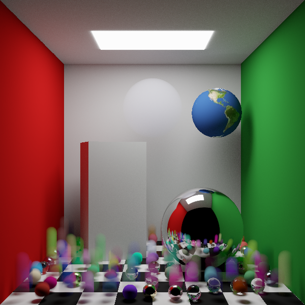<br>**`cornell`**: mirror sphere, textured Earth sphere, smoke sphere, checker floor and an emissive ceiling quad. | 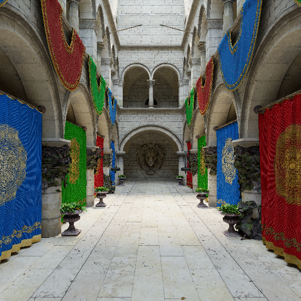<br>**`sponza`**: 262k triangles with its 24 MTL textures, lit by a sky quad and a sun above the open roof. |
| 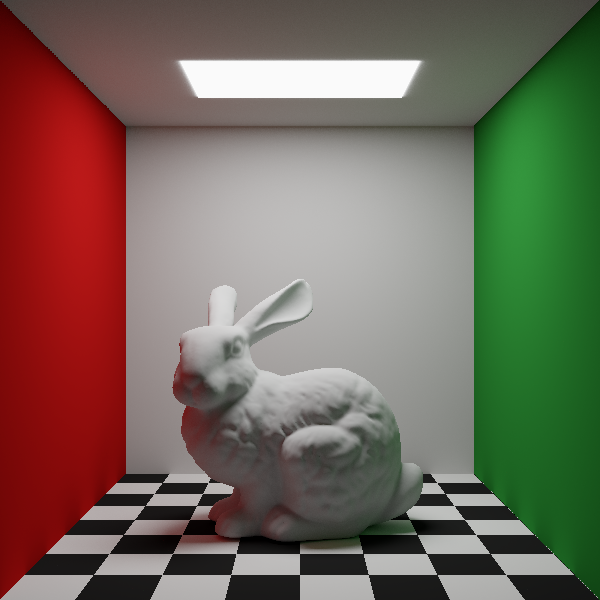<br>**`bunny`**: the Stanford bunny inside the Cornell box, smooth shaded from its vertex normals. | 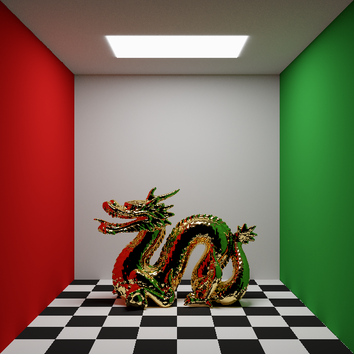<br>**`dragon`**: the Stanford dragon inside the Cornell box. |
| 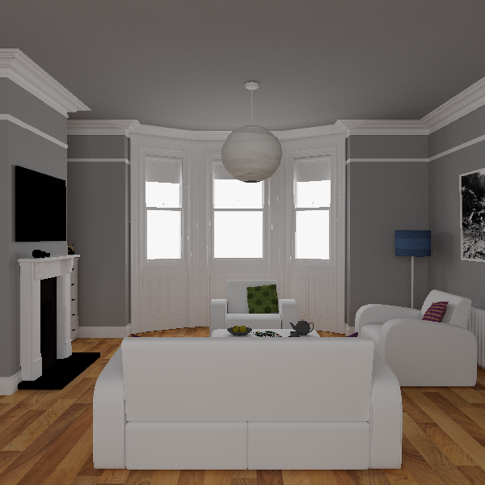<br>**`living_room`**: lit only through the emissive window panels of its own `.mtl`. | 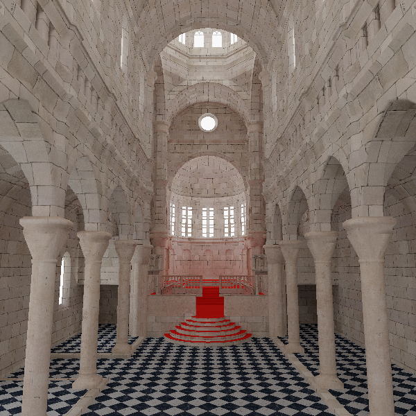<br>**`sibenik`**: the Sibenik cathedral, lit through the `staklo` window glass. |
| 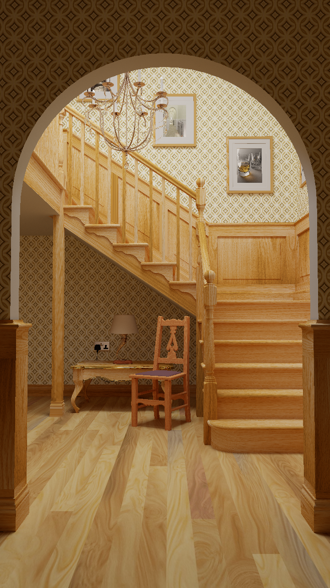<br>**`staircase`**: Bitterli's pbrt-v3 staircase, 720x1280. | 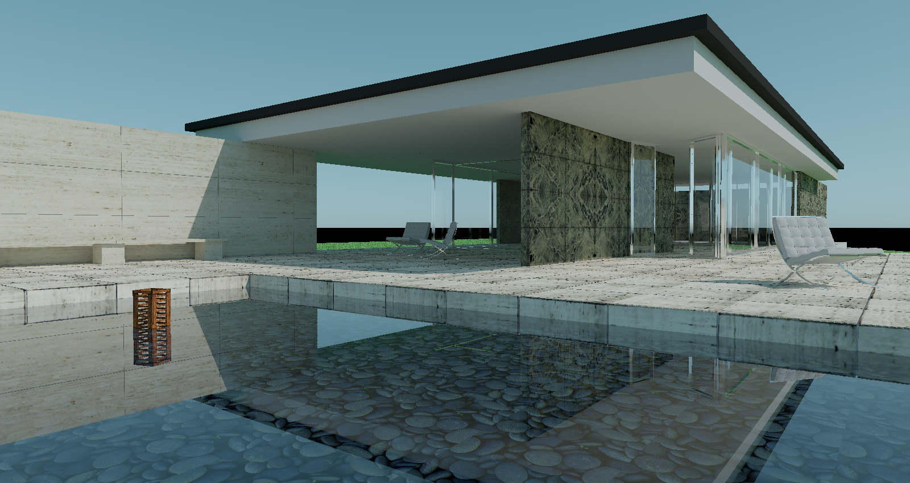<br>**`barcelona`**: the pavilion, 1600x850; the architecture only (130k triangles). |
| 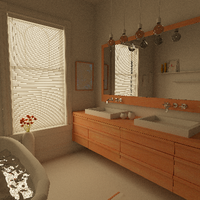<br>**`bathroom`**: the contemporary bathroom, 400x400. | 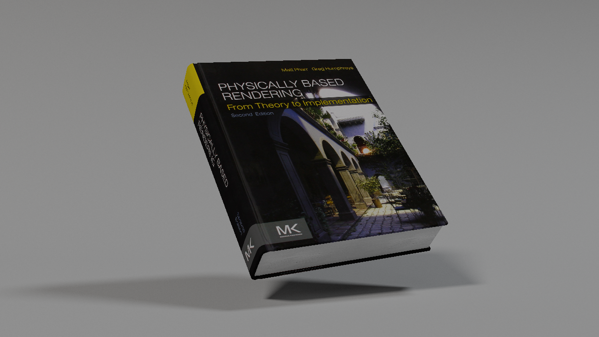<br>**`book`**: the pbrt book cover scene, 1280x720. |
| 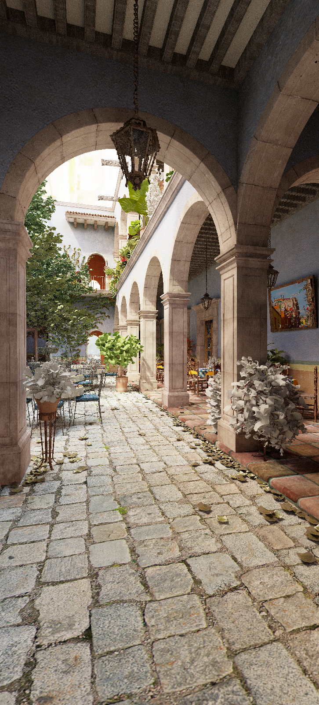<br>**`sanmiguel`**: the San Miguel courtyard, 726x1600. | 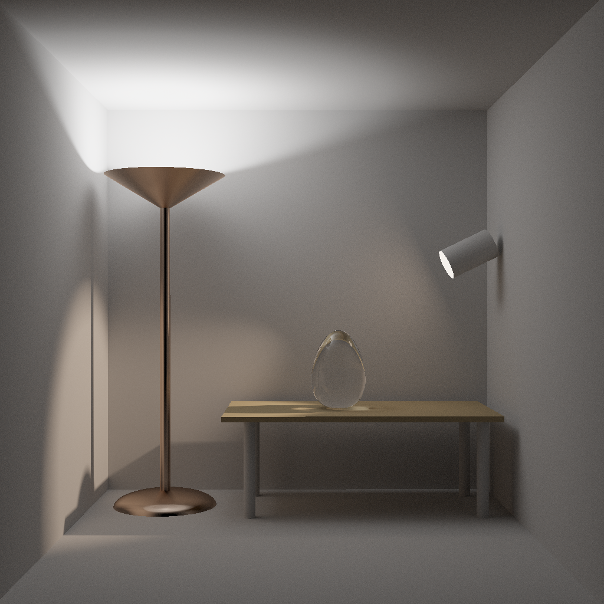<br>**`veach_bidir`**: the Veach bidirectional test room, 1024x1024 (the file is named `Scene12_Lamps`). |

The point and spot lights of the pbrt scenes are emulated with small emitters and their `distant` lights with a bright quad far away, so the lighting of the staircase, the bathroom, the book cover and San Miguel approximates what pbrt renders rather than matching it.

## Benchmarks

All numbers come from the release build on an RTX 5070 Laptop GPU (36 SMs). The laptop GPU throttles, so only numbers measured back to back in one session are comparable with each other. Every optimization below was checked to produce the same image as before (`cmp` where the result is bit-identical).

### Single-kernel versus wavefront

Settings: 600x600, 1000 samples per pixel, maximum path depth 20. Render loop only (BVH construction excluded), one run each.

| Scene | Primitives | Single-kernel | Wavefront | Speedup |
|---|---|---|---|---|
| Cornell box | 24 triangles + spheres | 13.99 s | 13.81 s | 1.01x |
| Sponza atrium | 262,268 triangles | 191.44 s | 105.36 s | 1.82x |

On the small Cornell scene both models take about the same time. A plausible reason, not verified with a profiler, is that the extra memory traffic of the wavefront path state cancels what it gains on such a small scene. On Sponza the wavefront version is clearly faster, most likely because rays traverse a large hierarchy incoherently, threads of a warp diverge more inside the single kernel, and compacting the active paths between bounces reduces that. These are single measurements and the Sponza scene used one placeholder material at that time, so treat them as a first data point.

### Effect of a 16-byte aligned AABB

Profiling the wavefront `extendKernel` on Sponza with Nsight Compute showed that about 76% of its global load requests came from reading the child bounding boxes during traversal. `AABB` was 36 bytes and unaligned (it carried an unused `centroid`), so the compiler emitted 12 separate 4-byte loads per box. Removing the unused field and padding the box to 32 bytes with `alignas(16)` lets it be read with vector loads (4 load instructions per box instead of 12); `BVH_Node` grows to exactly 64 bytes as a side effect.

| Sponza, wavefront, 1000 spp | Time | Mpaths/s | Speedup |
|---|---|---|---|
| Before (36-byte `AABB`, placeholder material) | 105.36 s | 3.42 | 1.00x |
| After (32-byte aligned `AABB`, MTL textures loaded) | 88.01 s | 4.09 | 1.20x |

Nsight Compute's estimated remaining speedup for `extendKernel` dropped from about 63% to 46.6%, and the kernel is now limited more by computation (57% of peak) than by memory throughput (30% of peak). The two runs differ in more than the layout: the second renders the textured Sponza, which adds shading work, so the gain from the layout alone is probably slightly larger than 1.20x.

### Effect of persistent threads in the extend kernel

With `--wavefront --persistent` the extend kernel launches a fixed grid that exactly fills the GPU. A lane that finishes its ray asks for a new one while the other lanes of its warp keep traversing: when at least 8 lanes of a warp are idle, one lane performs a single `atomicAdd` on a global work counter for the whole warp and the new queue slots are distributed to the idle lanes with a prefix popcount. The traversal loop was split into `beginTraversal` and `stepTraversal` so that a lane can carry its ray state across iterations. Every ray performs exactly the same operations in the same order; the image is byte-identical to the normal wavefront renderer.

| Sponza, wavefront, 1000 spp | Time | Mpaths/s | Speedup |
|---|---|---|---|
| Normal extend kernel | 88.11 s | 4.09 | 1.00x |
| Persistent threads (`--persistent`) | 78.23 s | 4.60 | 1.13x |

Both rows were measured back to back. Nsight Compute on the extend kernel at bounce depth 3 showed the average number of active threads per warp rising from 6.35 to 15.33, the kernel time dropping from 18.2 ms to 10.2 ms and registers per thread from 71 to 56. The gain on the whole frame is smaller because the extend kernel is only part of it: an `nsys` run showed the persistent extend kernel at 66% of the GPU time, the shadow-ray kernel at 28% and the shade kernel at 3%. The extend kernel is now limited by memory (about 80% of peak throughput), mostly local memory traffic from the traversal stack and scattered stores of the hit results.

### Effect of deferred hit shading

The extend kernel used to carry a full `hitRecord` (hit point, normal, front-face flag, UV and a copy of the `Material`) through the traversal and wrote it out as twelve separate arrays. Nsight Compute showed this as local-memory traffic inside the persistent traversal state and as scattered 4-byte stores that saturate L2. Now `extendKernel` only tracks the closest candidate (`distance`, `primitiveType`, `primitiveIndex`) and writes a single 16-byte `PackedHit`. `shadeKernel` reads it back and recomputes the hit point, normal, front-face flag and UV with the same formulas, so the extra arithmetic is paid once per hit instead of once per candidate triangle.

| Sponza, wavefront + persistent, 50 spp | Time | Mpaths/s | Speedup |
|---|---|---|---|
| Before (hit record built during traversal) | 3.975 s | 4.53 | 1.00x |
| After (`PackedHit`, shading data rebuilt in `shadeKernel`) | 3.540 s | 5.08 | 1.12x |

Mean of three runs measured back to back; the image is byte-identical to the one from before the change. `cuobjdump -sass` shows the number of local-memory instructions (`LDL`/`STL`) in `extendKernelPersistent` dropping from 139 to 33; most of the remaining ones belong to the traversal stack.

### Effect of the hot/cold triangle split

A BVH leaf test needs only the three vertices of a triangle, but the triangle struct also carried UVs, vertex normals, a `Material` and a bounding box (about 208 bytes), so every candidate triangle pulled several cache lines it never used. On upload the triangles are now split into `triangle_hot` (three vertices, 36 bytes) and `triangle_cold` (everything else), passed to the kernels together as a `TriangleView`. Traversal reads only the hot array; the cold array is read once per confirmed hit, in the shade kernel. The host-side loaders still build the original one-piece `triangle`.

| Sponza, wavefront + persistent, 50 spp | Time | Speedup |
|---|---|---|
| Before (one-piece triangle) | TBD s | 1.00x |
| After (hot/cold split) | TBD s | about 1.9x |

*(Fill in the measured times: mean of several runs, measured back to back in one session.)*

### Experiments that did not help

- **`__ldg` / read-only data path on the BVH loads:** no measurable change in time, so it was not kept.
- **Persistent threads in the shadow-ray kernel:** the average number of active threads per warp rose from 12.66 to 18.09, but the kernel got slower (4.10 ms to 4.31 ms, about 5% on the whole frame). The extra bookkeeping per traversal step costs more than the divergence it removes, because shadow rays are any-hit and terminate early. The change was reverted.
- **Splitting the hot vertices into three separate streams:** not done on purpose. A leaf test reads all three vertices together, so three streams would cost loads rather than save them.

A higher active-thread ratio therefore does not guarantee a faster kernel; the loop adds its own instructions.

## Implementation checklist

Everything below is implemented. What was left out is listed under [Future work](#future-work).

### 1. Core rendering pipeline
- [x] Device query and context setup (GPU name, compute capability, SM count)
- [x] `vec3` math library, `ray` type, camera-to-ray generation
- [x] Pinhole camera and thin-lens camera (aperture and focus distance)
- [x] HDR framebuffer accumulated across samples; progressive sample loop

### 2. Scene representation and acceleration structures
- [x] Sphere and triangle primitives
- [x] Hot/cold triangle layout and structure-of-arrays path state *(the 36-byte `triangle_hot` of the three vertices is what the BVH leaf test reads; `triangle_cold` with UVs, normals, material and box is read only after a confirmed hit. Both halves stay arrays of structs on purpose, since a leaf test reads all three vertices together. The remaining AoS read is `testPrimitiveHit` in the single-kernel renderer, which still builds a full hit record during traversal)*
- [x] LBVH construction *(Morton codes and sort on the CPU, Karras radix-tree construction and bounds refit on the GPU; primitives with identical Morton codes are separated by their index and `findSplit` uses the same `delta` function as `determineRange`, so such runs build a consistent tree)*
- [x] Iterative stack-based BVH traversal and AABB slab test
- [x] OBJ loading with MTL materials and textures, smooth shading from `vn`
- [x] pbrt-v3 scene import through minipbrt

### 3. Materials
- [x] Lambertian (cosine-weighted sampling), mirror, dielectric (Fresnel with Schlick), conductor with fuzz, emissive

### 4. Textures and surface detail
- [x] UV coordinates (spherical on spheres, barycentric on triangles), procedural checker, image textures
- [x] Image input: PPM reader, `stb_image` (PNG/JPG/HDR), `tinyexr` (EXR), in a separate host translation unit so the renderer stays one `.cu` file
- [x] PNG output through `stb_image_write`
- [x] Hardware-filtered sampling through `cudaTextureObject_t` *(textures are created with the sRGB flag, so the hardware converts them to linear on fetch)*

### 5. Light transport and sampling
- [x] Iterative Monte Carlo path integration with Russian roulette
- [x] Light list, uniform area sampling of triangle lights converted to solid angle, uniform light selection
- [x] Next event estimation and MIS (power heuristic) in both execution models
- [x] Environment map lighting with importance sampling *(a row CDF and per-row column CDFs over luminance times $\sin\theta$ are built once on the host; NEE picks the environment with probability 0.5 next to the area lights, 1.0 when the scene has none, samples a texel, jitters inside it and sends an unbounded shadow ray; the pdf is converted to solid angle, $p(\omega)=\frac{w_\text{texel}}{W_\text{total}}\cdot\frac{WH}{2\pi^2\sin\theta}$, and both the environment and the area lights get the matching selection probability in the power heuristic)*

### 6. Volumetric rendering
- [x] Homogeneous participating medium *(sphere-bounded `Isotropic` material with density and albedo; analytic free-flight distance sampling, NEE from the scattering point and transmittance on shadow rays, in both renderers)*
- [x] Henyey-Greenstein phase function *(sampled from its inverse CDF around the incoming direction; the phase function is normalized, so it doubles as the pdf for NEE and the MIS power heuristic. `g` comes from the medium in pbrt scenes or from `--phase-g`, and at `g = 0` it reduces to the isotropic $1/4\pi$ exactly, which keeps older renders reproducible)*

### 7. Motion blur
- [x] Per-sample time on each ray, time-interpolated sphere centers, BVH box covering the full motion range

### 8. GPU architecture
- [x] Iterative kernels throughout, verified with `cuobjdump --dump-resource-usage`
- [x] Persistent per-pixel RNG state
- [x] Occupancy measurement and Nsight Compute profiling at several milestones
- [x] Wavefront path tracing with atomic-counter path queues, a separate shadow-ray queue and SoA path state
- [x] Any-hit traversal for shadow rays *(wavefront shadow kernel, unless the scene contains a medium)*
- [x] Persistent threads in the extend kernel *(warp-aggregated work counter, 1.13x on Sponza, bit-identical image)*
- [x] 16-byte aligned `AABB`, deferred hit shading, hot/cold triangle split (see Benchmarks)

### 9. Image output and post-processing
- [x] Tone mapping (`none`, Reinhard, ACES approximation), manual and automatic exposure, exact sRGB transfer, PNG output

### 10. Tooling and validation
- [x] Command-line scene selection and options, interactive terminal menu
- [x] Before/after numbers for every optimization, recorded in this README
- [x] Cornell box and Sponza test scenes plus the ten further scenes shown in the gallery

## Future work

These are not implemented, although I will be moving on with my next big project which hopefully will be a very professional graphics engine written in C++/Vulkan. But also keep in mind that I'll be still contributing to this project because I'm having tons of fun while doing so ! So I am thinking of implementing these features and of course doing performance upgrades to get better and more comfortable with Nsight Compute, but in time...

- SAH BVH build; motion-aware BVH; `const __restrict__` kernel parameters and child bounds stored inside the parent BVH node (the remaining open points of the memory-access audit)
- Microfacet (GGX) BSDF, energy-conserving material blending, normal mapping, roughness and metallic maps
- Sphere light sampling; stratified or low-discrepancy sampling
- Heterogeneous volumes (3D density grid, for smoke and cloud data)
- Material-sorted shading
- Denoiser (edge-avoiding à-trous filter on albedo-demodulated irradiance)
- A benchmark harness reporting rays/s at fixed sample counts

## Third-party code

| Library | Use | License |
|---|---|---|
| [minipbrt](https://github.com/vilya/minipbrt) | pbrt-v3 parsing and PLY reading | MIT |
| [stb_image / stb_image_write](https://github.com/nothings/stb) | image decoding, PNG output | public domain / MIT |
| [tinyexr](https://github.com/syoyo/tinyexr) | OpenEXR decoding | BSD-3-Clause |

They are downloaded by CMake at configure time (pinned versions) and are not part of this repository. The models and scenes keep their own licenses.

## References

- Peter Shirley, Trevor David Black, Steve Hollasch: *Ray Tracing in One Weekend*, *The Next Week*, *The Rest of Your Life* (https://raytracing.github.io/)
- NVIDIA Developer Blog: "Accelerated Ray Tracing in One Weekend in CUDA" (https://developer.nvidia.com/blog/accelerated-ray-tracing-cuda/)
- Tero Karras, NVIDIA Developer Blog: "Thinking Parallel, Part II: Tree Traversal on the GPU" (https://developer.nvidia.com/blog/thinking-parallel-part-ii-tree-traversal-gpu/)
- Tero Karras, NVIDIA Developer Blog: "Thinking Parallel, Part III: Tree Construction on the GPU" (https://developer.nvidia.com/blog/thinking-parallel-part-iii-tree-construction-gpu/)
- ToruNiina/lbvh (https://github.com/ToruNiina/lbvh): used as a reference while designing and debugging MonoCUDA-PT's own LBVH construction and traversal; not used as source code

### Reference books

<p>
  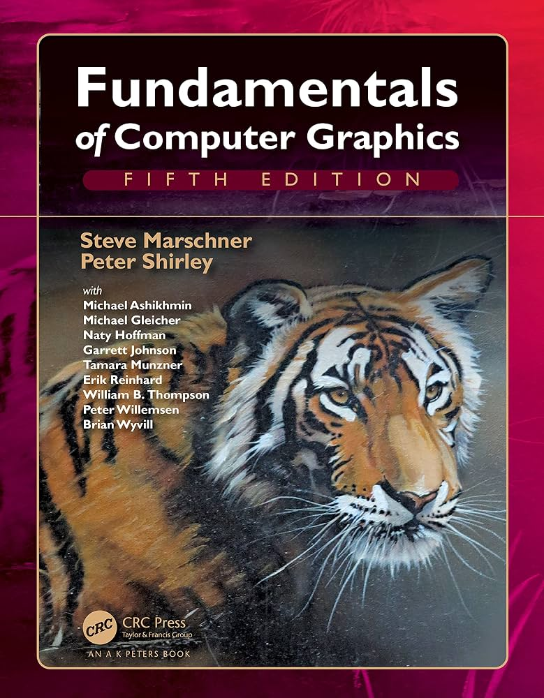
  &nbsp;&nbsp;
  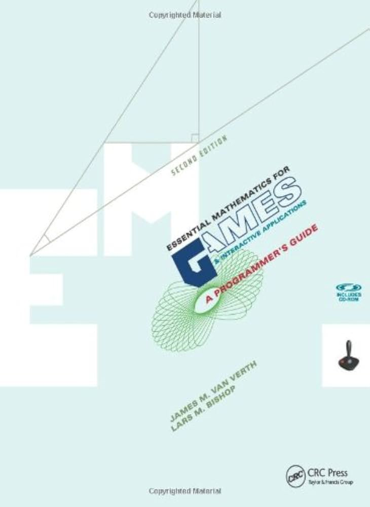
</p>

- Steve Marschner, Peter Shirley: *Fundamentals of Computer Graphics*, Fifth Edition, CRC Press / A K Peters
- James M. Van Verth, Lars M. Bishop: *Essential Mathematics for Games and Interactive Applications: A Programmer's Guide*, Second Edition, CRC Press

## Blog

I write about the process of building this project (BVH construction, profiling with Nsight Compute and more) on my portfolio website: [borayalcinn.github.io](https://borayalcinn.github.io/)

## License

MIT License.
