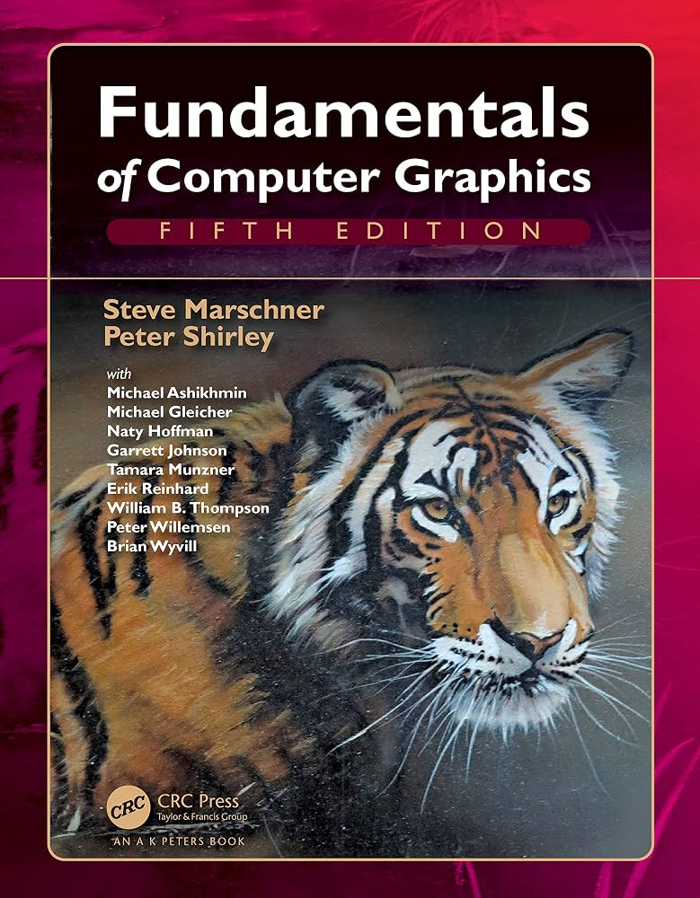
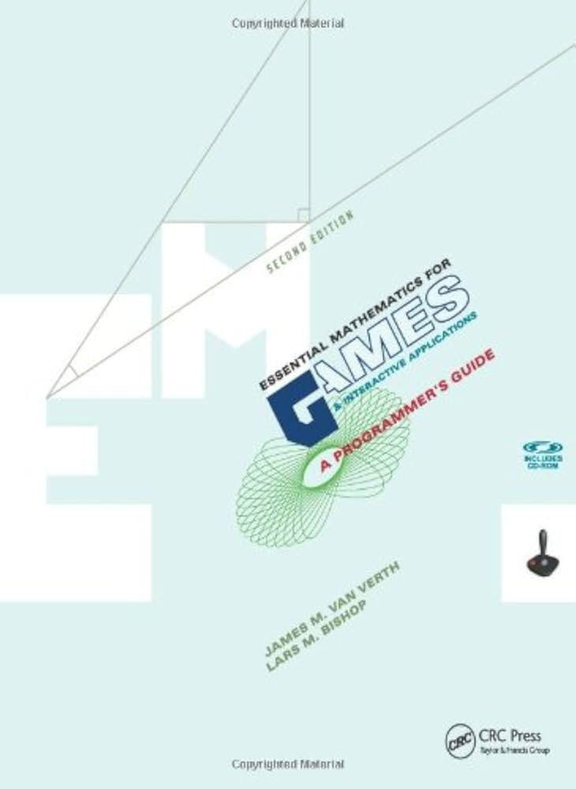

# MonoCUDA-PT
MonoCUDA is an original CUDA path tracer written as a single source file. It was started after completing Peter Shirley's Ray Tracing in One Weekend series in C++, with the goal of understanding how physically based rendering, specifically Monte Carlo path integration, maps onto GPU hardware rather than a single CPU thread. It is not based on or derived from NVIDIA's official CUDA port of the same book.

The renderer is deliberately kept in one file. The intent is for the source to read as a continuous explanation of a GPU path tracer's design, from ray generation through BVH traversal, material evaluation, and light transport, rather than as a general-purpose rendering engine split across many files. Kernels are written iteratively rather than recursively, since recursion on GPU forces register spilling and reduces occupancy.

The project follows a standard Monte Carlo path tracing formulation: primary rays are generated per pixel, intersected against scene geometry accelerated by a bounding volume hierarchy, and shaded using physically based materials (diffuse, dielectric, conductor, and emissive). Direct lighting uses next event estimation (NEE) with shadow rays against area lights, combined with BSDF sampling through multiple importance sampling (power heuristic). The renderer supports motion blur through time-sampled rays and moving spheres, and textured surfaces: solid colors, a procedural checker and image textures, with UV mapping on spheres and triangles and hardware-filtered image sampling through `cudaTextureObject_t`. Triangle meshes can be loaded from Wavefront OBJ files (`v`, `vt` and `f`, flat shaded) together with their MTL materials (`Kd` and `map_Kd`), and the renderer ships with two selectable test scenes: a Cornell box and the Sponza atrium. Correctness checks against a CPU reference implementation are planned (see below checklist). Measured single-kernel versus wavefront timings are listed in the Benchmarks section.

Two execution models are implemented side by side and produce the same image: a single-kernel path tracer (the default), where one thread follows a whole path, and a wavefront path tracer (`--wavefront`), which splits every bounce into separate extend, shade and shadow-ray kernels connected by compacted path queues and a structure-of-arrays path state. The wavefront version raises the average number of active threads per warp from about 7 to about 27 on the first bounce, at the cost of extra memory traffic.

Building requires the CUDA Toolkit (12.x or later), CMake 3.24 or later, and a CUDA-capable NVIDIA GPU. From the repository root:

```
cmake --preset release
cmake --build --preset release
./build/release/monocuda                                  # single-kernel path tracer, Cornell box
./build/release/monocuda --wavefront                     # wavefront path tracer
./build/release/monocuda --scene sponza --spp 1000       # choose the scene and the sample count
```

The render is written to `render_megakernel.ppm` or `render_wavefront.ppm` in the current directory, depending on the execution model. The Cornell box scene loads an `earth.ppm` image texture (binary PPM, P6) from the current directory. `--scene` selects `cornell` (default) or `sponza`, and `--spp N` overrides the number of samples per pixel. The Sponza model is not part of the repository. Download the OBJ version from the McGuire Computer Graphics Archive (https://casual-effects.com/data/), respect the `copyright.txt` that comes with it, and extract it so that `models/sponza.obj` exists. The loader also reads `models/sponza.mtl` (`newmtl`, `Kd`, `map_Kd`; other keywords are ignored). Image textures have to be binary PPM (P6, 8 bit) next to the original file with the extension replaced by `.ppm`, since the loader has no image decoders. Convert them once with ImageMagick:

```
grep -h "map_Kd" models/sponza.mtl | tr -d '\r' | awk '{print $NF}' | tr '\\' '/' | sort -u | while read f; do magick "models/$f" -depth 8 "ppm:models/${f%.*}.ppm"; done
```

The console reports `N materials, M textures loaded, K materials with a missing texture` when the model is loaded. A material whose texture is missing falls back to its `Kd` color. Alpha-masked parts of Sponza (leaves, chains, plants) are not supported yet and render as solid quads. The output has no gamma or tone mapping step yet, so colors look darker and flatter than in other renderers.

The project's implementation status is tracked in CHECKLIST.md. It is licensed under the MIT License.

# Benchmarks

Single-kernel versus wavefront path tracing, measured with the release build on an RTX 5070 Laptop GPU (36 SMs). Settings: 600x600 pixels, 1000 samples per pixel, maximum path depth 20. Times are the render loop only (BVH construction excluded), one run each.

| Scene | Primitives | Single-kernel | Wavefront | Speedup |
|---|---|---|---|---|
| Cornell box | 24 triangles + spheres | 13.99 s | 13.81 s | 1.01x |
| Sponza atrium | 262,268 triangles | 191.44 s | 105.36 s | 1.82x |

On the small Cornell scene both execution models take about the same time. A plausible reason, not yet verified with a profiler, is that the extra memory traffic of the wavefront path state cancels what it gains on such a small scene. On Sponza the wavefront version is clearly faster, most likely because rays traverse a large hierarchy incoherently, threads of a warp diverge more inside the single kernel, and compacting the active paths between bounces reduces that. These are single measurements and the Sponza scene used one placeholder material at that time, so treat the numbers as a first data point rather than a full benchmark.

## Effect of a 16-byte aligned AABB

Profiling the wavefront `extendKernel` on Sponza with Nsight Compute showed that about 76% of its global load requests came from reading the child bounding boxes during traversal. `AABB` was 36 bytes and unaligned (it carried an unused `centroid`), so the compiler emitted 12 separate 4-byte loads per box. Removing the unused field and padding the box to 32 bytes with 16-byte alignment (`alignas(16)`) lets it be read with vector loads (4 load instructions per box instead of 12 in the source view); `BVH_Node` grows to exactly 64 bytes as a side effect.

| Sponza, wavefront, 1000 spp | Time | Mpaths/s | Speedup |
|---|---|---|---|
| Before (36-byte `AABB`, placeholder material) | 105.36 s | 3.42 | 1.00x |
| After (32-byte aligned `AABB`, MTL textures loaded) | 88.01 s | 4.09 | 1.20x |

Nsight Compute's estimated remaining speedup for `extendKernel` dropped from about 63% to 46.6%, and the kernel is now limited more by computation (57% of peak) than by memory throughput (30% of peak). The two runs differ in more than the `AABB` layout: the second one renders the textured Sponza, which adds shading work, so the gain from the layout change alone is probably slightly larger than 1.20x. The single-kernel path tracer has not been re-measured since this change.

# Implementation Checklist

## 1. Core Rendering Pipeline
- [x] Device query + context setup (print GPU name, compute capability, SM count)
- [x] `vec3`/`float3` math library (add/sub/scale/dot/cross/normalize/reflect/refract)
- [x] `ray` type + camera-to-ray generation
- [x] Pinhole camera (position, look-at, FOV, aspect ratio)
- [x] Thin-lens camera model — aperture + focus distance (depth of field)
- [x] HDR framebuffer (float3/float4 per pixel), accumulated across samples
- [x] Progressive rendering loop (N samples/pixel, accumulate + save incrementally)

## 2. Scene Representation & Acceleration Structures
- [x] Primitive types: sphere, and at least one more (triangle)
- [ ] Structure-of-arrays scene layout (not array-of-structs) for coalesced access *(path state and hit results are already SoA in the wavefront renderer; scene geometry is still array-of-structs. For BVH nodes a compact, aligned array-of-structs is the better layout, since a traversal step reads whole nodes; the open item is a hot/cold split of the triangle data)*
- [x] BVH construction (LBVH build via Morton codes + Karras parallel radix-tree algorithm; Morton codes and sort on the CPU, tree construction and bounds refit on the GPU; primitives with identical Morton codes are separated by their index, and `findSplit` uses the same `delta` function as `determineRange` so that such runs build a consistent tree)
- [x] BVH traversal (device-side, iterative, stack-based — no recursion)
- [x] Bounding-box (AABB) intersection + slab test
- [ ] **(stretch)** SAH (surface area heuristic) BVH build for better traversal quality
- [x] **(stretch)** Basic OBJ mesh loading so you can render more than primitives *(dependency-free parser for `v`, `vt` and `f` with negative indices and polygon fan triangulation; the model is centered, scaled, rotated around Y and translated into the scene; flat shading only)*
- [x] **(stretch)** MTL parsing so loaded models keep their original per-material colors and textures (`Kd`, `map_Kd`) *(`newmtl`, `Kd` and `map_Kd` only; textures are binary PPM converted offline, cached by path; alpha masks, `Ks`, bump maps and texture options are ignored)*
- [ ] **(stretch)** Smooth shading from OBJ vertex normals (`vn`) or averaged vertex normals

## 3. Materials / BSDFs
- [x] Lambertian (diffuse) BSDF — cosine-weighted hemisphere sampling
- [x] Specular/mirror reflection
- [x] Dielectric (glass) BSDF — Fresnel + refraction (Schlick approximation)
- [x] Rough conductor (metal) BSDF — at least a fuzz/roughness parameter
- [x] Emissive materials (area light sources built from geometry)
- [ ] **(stretch)** Real microfacet BSDF (GGX distribution) instead of ad-hoc fuzz
- [ ] **(stretch)** Energy-conserving material blending (e.g. dielectric-coated diffuse)

## 4. Textures & Surface Detail
- [x] UV coordinates on primitives (spherical mapping for sphere, barycentric for triangle)
- [x] Procedural checker texture and a `Texture` struct (solid / checker / image) wired into the materials' albedo
- [x] Image loading — dependency-free binary PPM (P6) reader into RGBA8 host memory (PNG/JPG/HDR are converted offline, no `stb_image`, to keep the project single-file)
- [x] Hardware-accelerated sampling via `cudaTextureObject_t` (bilinear filtering on the GPU, wrap addressing) *(sampled without the sRGB conversion for now, since the output has no gamma step yet; see Image Output)*
- [ ] **(stretch)** Normal mapping (tangent-space perturbation of the shading normal)
- [ ] **(stretch)** Roughness/metallic texture maps for the conductor BSDF

## 5. Light Transport & Sampling
- [x] Monte Carlo path integration — iterative bounce loop, not recursive
- [x] Russian roulette path termination (unbiased early exit)
- [x] Light list construction — collect emissive primitives from the scene into a separate array
- [x] Light sampling — pick a point on a triangle light (uniform area sampling) and compute its PDF, converted to solid angle
- [ ] Light sampling for sphere lights (solid-angle / cone sampling)
- [x] Light selection strategy for multiple lights (uniform; power-weighted is a possible upgrade)
- [x] Next event estimation (NEE) — explicitly sample lights each bounce instead of relying on BSDF sampling alone to find them
- [x] Multiple importance sampling (MIS) between light sampling and BSDF sampling — power heuristic, implemented in both the single-kernel and the wavefront path tracer *(on the current mostly diffuse scene with one small area light it does not reduce noise measurably, since NEE alone is already near-optimal there; its benefit shows up with large lights and glossy surfaces)*
- [x] Cosine-weighted / importance-sampled BSDF sampling (not uniform hemisphere)
- [ ] **(stretch)** Environment map (HDRI) lighting with importance sampling
- [ ] **(stretch)** Stratified or low-discrepancy sampling (e.g. Sobol/blue-noise) instead of pure `curand` uniform — measurably reduces noise at equal sample count

## 6. Volumetric Rendering
- [ ] Homogeneous participating media (constant-density fog/smoke)
- [ ] Ray marching through volume bounds — absorption + scattering along the path
- [ ] Henyey-Greenstein phase function for scattering direction
- [ ] **(stretch)** Heterogeneous volumes (3D voxel grid for density — real smoke/cloud data)

## 7. Motion Blur
- [x] Per-sample time value on each ray (random within the shutter interval)
- [x] Time-interpolated primitive transforms (e.g. `center0`/`center1` lerp'ed by `time` for a moving sphere)
- [x] BVH handling for moving primitives — expanded bounding box covering the full motion range
- [ ] **(stretch)** Proper motion-aware BVH instead of a single expanded box per moving primitive

## 8. GPU Architecture-Specific Design
- [x] Iterative (not recursive) kernels throughout — verified with the register/stack usage report (`cuobjdump --dump-resource-usage`, equivalent to `nvcc --ptxas-options=-v`)
- [x] Persistent per-pixel RNG state, not reinitialized per sample
- [ ] Memory access audit: confirm scene/material reads go through `__ldg`/`const __restrict__` *(profiling showed plain `LDG.E` loads in `extendKernel`; the 16-byte aligned `AABB` is done, `const __restrict__` kernel parameters and the child bounds stored inside the parent node are still open)*
- [x] Occupancy measurement (Nsight Compute or `nvidia-smi`) at a baseline milestone
- [x] **(stretch)** Wavefront path tracing — split trace/shade into separate kernels with stream compaction between bounces (this is how real production renderers like PBRT-on-GPU or Blender Cycles handle divergence; a genuine architectural upgrade over "one big kernel does everything") *(implemented with atomic-counter path queues, a separate shadow-ray queue for NEE, and SoA path state; selectable with `--wavefront`)*
- [ ] **(stretch)** Material-sorted shading — sort active paths by material ID before shading to reduce warp divergence
- [x] **(stretch)** Any-hit traversal for shadow rays (early exit on the first occluder, no hit record) *(used by the wavefront shadow kernel; the single-kernel path tracer still uses closest-hit traversal with a max distance)*
- [ ] **(stretch)** Persistent threads / dynamic work fetching in BVH traversal to reduce divergence on incoherent bounces

## 9. Image Output & Post-Processing
- [ ] Tonemapping operator (start with Reinhard or ACES-approx, not just clamp)
- [ ] Gamma correction (linear → sRGB)
- [ ] PNG output (not just PPM) so renders are shareable without conversion
- [ ] **(stretch)** Simple denoiser pass (even a basic bilateral/edge-aware filter counts) to demonstrate you understand the variance-reduction vs. denoising trade-off

## 10. Tooling & Validation
- [ ] Benchmark harness reporting rays/sec and ms/frame at fixed sample counts
- [x] Numbers for at least one "before vs. after" optimization (e.g. BVH vs. brute force, or single-kernel vs. wavefront) recorded in the repo *(single-kernel versus wavefront on Cornell and Sponza, see Benchmarks)*
- [x] Command-line scene selection (a couple of hardcoded test scenes, switchable via flag) *(`--scene cornell|sponza`, plus `--spp N` for the sample count)*
- [x] Cornell box test scene (quads and a box built from triangles, emissive ceiling light, mirror sphere, many small spheres on the floor, a checker floor and a textured Earth sphere)
- [x] Sponza atrium test scene (262k triangles loaded from the McGuire OBJ with its MTL materials and 24 textures, a skylight quad above the open roof as the only light)

## References

- Peter Shirley, Trevor David Black, Steve Hollasch — *Ray Tracing in One Weekend* / *Ray Tracing: The Next Week* / *Ray Tracing: The Rest of Your Life* (https://raytracing.github.io/)
- NVIDIA Developer Blog — "Accelerated Ray Tracing in One Weekend in CUDA" (https://developer.nvidia.com/blog/accelerated-ray-tracing-cuda/)
- Tero Karras, NVIDIA Developer Blog — "Thinking Parallel, Part II: Tree Traversal on the GPU" (https://developer.nvidia.com/blog/thinking-parallel-part-ii-tree-traversal-gpu/)
- Tero Karras, NVIDIA Developer Blog — "Thinking Parallel, Part III: Tree Construction on the GPU" (https://developer.nvidia.com/blog/thinking-parallel-part-iii-tree-construction-gpu/)
- ToruNiina/lbvh (https://github.com/ToruNiina/lbvh) — used as a reference while designing and debugging MonoCUDA-PT's own LBVH construction and traversal; not used as source code

## Blog

I write about the process of building this project (BVH construction, profiling with Nsight Compute, and more) on my portfolio website: [borayalcinn.github.io](https://borayalcinn.github.io/)

## Reference Books

<p>
  
  &nbsp;&nbsp;
  
</p>

- Steve Marschner, Peter Shirley — *Fundamentals of Computer Graphics*, Fifth Edition, CRC Press / A K Peters
- James M. Van Verth, Lars M. Bishop — *Essential Mathematics for Games and Interactive Applications: A Programmer's Guide*, Second Edition, CRC Press